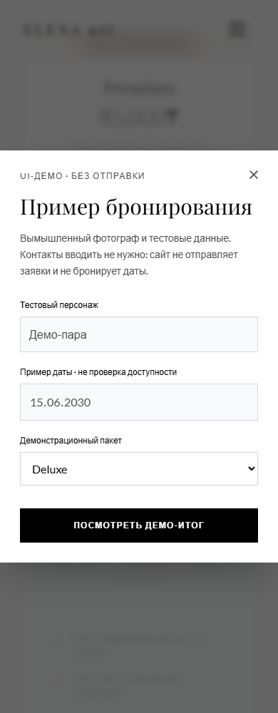

# Elena Art — демонстрационный сайт фотографа

React/TypeScript-портфолио **вымышленного** свадебного фотографа. Проект показывает адаптивную галерею, пакеты съёмки и доступный сценарий выбора пакета. Реальные услуги, заявки и бронирования отсутствуют.

Автор проекта и frontend-разработчик — **Максим Асатуров**; использовались AI-assisted инструменты. Фотографии принадлежат авторам Unsplash, не являются работами разработчика и не изображают его клиентов. Цифры «8 лет» и «200+ свадеб» удалены: они не подтверждают профессиональный опыт автора сайта.

## Что работает

- Якорная навигация, мобильное меню, галерея и три демонстрационных пакета.
- Выбранный пакет переносится в диалог; его можно изменить и просмотреть локальный итог.
- Имя и дата — готовые read-only примеры. Полей телефона, почты и свободного текста нет.
- Диалог имеет связанные labels, удержание фокуса, Escape, закрытие по фону, возврат фокуса и сброс состояния при новом открытии.
- Итог прямо сообщает: заявка не отправлялась, дата не бронировалась, обратная связь не предусмотрена. Таймеров, имитации API и логирования контактов нет.

## Скриншоты




## Стек и запуск

React 19, TypeScript, Vite 7, Framer Motion, Lucide React. Node.js 22.12+.

```sh
npm ci
npm run dev -- --host 127.0.0.1
```

Production-сборка использует существующий base `/wedding-photographer-portfolio/`:

```sh
npm run build
npm run preview -- --host 127.0.0.1
```

Локальный preview открывается по `/wedding-photographer-portfolio/`; dev-сервер — по `/`. Preview учитывает тот же base, что production-сборка.

[Существующая ссылка GitHub Pages](https://vortexfront.github.io/wedding-photographer-portfolio/). Изменения этой ветки не считаются опубликованными до отдельного подтверждения владельца; ссылка может показывать прежнюю версию.

## Проверки

```sh
npm run lint
npm run typecheck
npm run build
npx playwright install chromium
npm run test:e2e
```

Playwright проверяет выбор пакета/честный итог, отсутствие контактных полей и исходящих изменяющих запросов, reset-on-reopen, фокус/Tab/Shift+Tab/Escape/фон, навигацию, метаданные и отсутствие document overflow на 390/768/1440px. Проверка source дополнительно исключает таймеры и симулированный API. CI выполняет сборку и проверки с `contents: read`; шагов публикации Pages нет.

## Ограничения и контент

- Это статическое UI-демо: нет сервера, проверки доступности, доставки сообщений, оплаты, аккаунтов или сохранения формы после перезагрузки.
- Tailwind CDN и Google Fonts сохранены, чтобы ограничить изменения дизайна. Для первого открытия нужен интернет; автономная работа и отказ CDN не гарантируются. Миграция Tailwind в локальную сборку отложена, а не объявлена выполненной.
- Социальные иконки ведут на главные страницы платформ, не на профили вымышленного фотографа. Контактные примеры не активируют звонок или письмо.
- [Точные источники изображений и проверенные условия Unsplash](IMAGE_CREDITS.md). Ссылки на изображения проверены на HTTP 200; будущая доступность стороннего CDN не гарантируется. Индивидуальные model/property releases не проверялись, одобрение изображёнными людьми не подразумевается.
- Браузерные автотесты не являются полной проверкой всех браузеров или сертификацией доступности. Ручная проверка и фактические результаты PR учитываются отдельно в общем отчёте.
- Выполнены совместимые обновления lockfile без `--force`. Для `@typescript-eslint/typescript-estree` временно закреплён исправленный `minimatch 11.0.4`; lint/typecheck/build и audit проверяются после установки. Override следует убрать после исправления upstream и повторить проверки.
